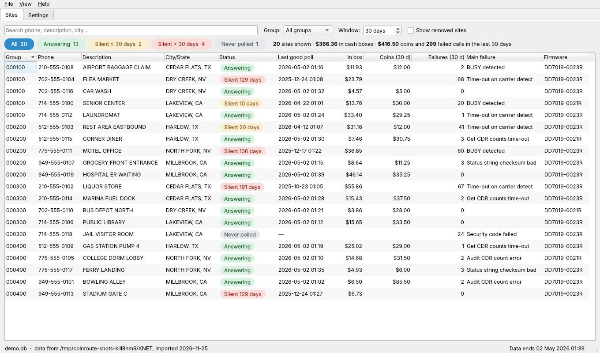

# coinroute

A modern replacement for **Protel ExpressNet 3**, the DOS program that manages
Protel smart payphones (7000/8000-series boards). Goal: run on Windows, Linux
and macOS, read an existing ExpressNet installation, and eventually poll and
program the phones itself through the Protel UPMS1200 modem.

> Working name. Not affiliated with Protel, Inc.

## Status

| Milestone | State |
|---|---|
| 1. Import an ExpressNet folder (C:\XNET) into SQLite | **working** — sites, coin polls, comm errors, call accounting, audit calls, settings, logins |
| 2. Desktop app (PySide6): sites, cash boxes, failures, calls, settings | **working** |
| 3. Decode the remaining fields (status flags, rates, options, call details) | in progress — see [FORMATS.md](FORMATS.md) |
| 4. Payphone protocol + simulated payphone for bench tests | planned |
| 5. Polling service (nightly polls, incoming calls) via UPMS1200 | planned |
| 6. Programming: rates, options, firmware downloads | planned |

## Use

Python 3.11+. The importer and CLI need no extra packages; the desktop app
needs PySide6.

```sh
pip install -e '.[gui]'               # or just `pip install -e .` for the CLI only
coinroute gui                         # desktop app (or: coinroute-gui, python -m coinroute.gui)
coinroute gui route.db                # ...opening a database straight away
```

In the app, **File → Import ExpressNet folder…** picks the XNET folder (a
copy of C:\XNET is fine), writes a new database file and opens it. The
import runs in the background with a progress window and finishes with a
summary of what was read and any damage that was skipped.



- **Sites**: every phone with its status (answering / silent ≤ 30 days /
  silent longer / never polled), last good poll, cash in the box, coins and
  failed calls over a window you choose, and the most common failure. Search,
  filter by group or status, sort any column. "Show removed sites" adds
  phones whose site record was deleted but whose history is still there.
- **A site** (double-click): its fields; a chart of cash in box and lifetime
  coins with the days the box was emptied; communication errors by cause;
  every call (loaded page by page, with a date filter); call-accounting
  periods.
- **Settings**: system record, users (passwords hidden until you ask),
  ports, modems, poll lists, groups, rate and option records.

Statuses are measured from the end of the data ("data ends" in the status
bar), not from today, so an old import still reads sensibly.

The same data from the command line:

```sh
coinroute import /path/to/XNET route.db
coinroute summary route.db            # which phones answer, cash in box, failures (--removed: deleted sites too)
coinroute export-csv route.db out/    # every table as CSV (add --calls for call records)
coinroute users /path/to/XNET         # ExpressNet logins and passwords
```

The XNET folder is only read. Every imported row keeps the original record
bytes, so a later version can decode more fields from the same database.

### Try it without real data

```sh
coinroute demo /tmp/demo              # a made-up route: 20 phones, 400 days, some dead, one damaged file
coinroute import /tmp/demo/XNET /tmp/demo.db
coinroute gui /tmp/demo.db
```

## Docs

- [FORMATS.md](FORMATS.md) — ExpressNet file layouts
- [docs/ROADMAP.md](docs/ROADMAP.md) — milestones and the next one in detail
- [docs/REVERSE_ENGINEERING.md](docs/REVERSE_ENGINEERING.md) — what is known about XNET.EXE
- [docs/PROTOCOL.md](docs/PROTOCOL.md) — how ExpressNet talks to a phone, as far as known
- [CLAUDE.md](CLAUDE.md) — rules and commands for working on this repo

## Tools

- `tools/fake_upms.py` — a stand-in for the Protel UPMS1200 modem, to test
  ExpressNet (in a VM) or coinroute without the real modem. `--simphone CODE`
  puts a simulated payphone behind it. See its `--help`.
- `tools/re/ne.py` — helper for studying XNET.EXE (bring your own copy).
- `tools/screenshots.py` — renders every screen of the app from the demo
  route to PNG files (works headless: `QT_QPA_PLATFORM=offscreen`).
- `tools/serial_tap.py` — sits between ExpressNet and the UPMS1200 and logs
  every byte both ways (`--pty` for an emulator's COM port); `--decode` shows
  the phone frames in a log. Logs contain real data: keep them out of git.
- `tools/try-it.sh` — one command to update a checkout, install into `.venv`,
  run the tests and open the app on the demo route: `bash tools/try-it.sh`
  (`--shots` also saves screenshots as your desktop draws them, `--no-gui`
  stops before opening the app, `--system-qt` uses your distribution's
  PySide6 — on KDE that is the one that draws with Breeze).

## Tests

```sh
pip install -e '.[gui]' pytest pytest-qt
pytest                                        # GUI tests run headless when there is no display
COINROUTE_REAL_XNET=/path/to/XNET pytest     # extra checks against a real installation
```

Tests use synthetic data only. **Never commit customer data**; `.gitignore`
blocks `*.DAT`, `*.IDX` and `*.db`.
